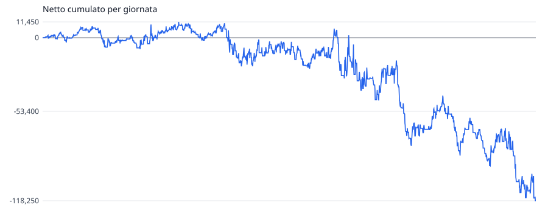
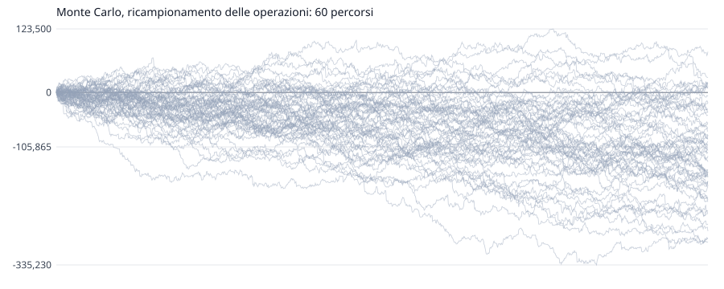

# scala-dei-tre-tempi: validazione dentro campione

Generato il 2026-11-05 12:10 da `quant valida`. Impronta `2a681e9f8c`, versione 1. Superare i cancelli **non approva** una regola operativa: dice che la prova non l'ha smentita.

## Le Regole

Tempi sg (m mese, s settimana, g giorno), memoria scalino (una pausa non cancella l'ultimo scalino). Scalino su = massimo piu' alto, minimo piu' alto e chiusura sopra il massimo precedente; giu' rovesciato. Ingresso: se tutti i tempi sono nello stesso verso, a mercato alle 09:30 ET in quel verso; con tempi misti niente. Uscita: alle 16:00 ET. Nessuno stop. Dimensione: dai parametri.

L'idea, il paper e il perche': `quant/studi/scala-dei-tre-tempi/1-idea.md`.

- **Parametri**: `contratti=1 dimensione=fissa entra=09:30 esce=16:00 maxContratti=50 memoria=scalino tempi=sg`
- **Dimensione**: fissa, 1 contratto
- **Esecuzione**: commissione 2,50 $/lato, slittamento 1 tick su mercato e stop, limite solo se attraversato, ambiguita' al peggio
- **Dati**: NQ m1, rettificata all'indietro ai rollover
- **Divisione**: dentro fino al 2024-12-31 compreso, fissata il 2026-10-15 (80% di 2457 giornate)

## I Cancelli

| | condizione | valore | |
|---|---|---|---|
| D1 | dentro: batte lo stare nel mercato a caso, stesso verso e stessa esposizione (p <= 0,05) | p = 0,894 | **non passa** |
| D2 | dentro: il verso scelto batte la moneta (p <= 0,05) | p = 0,854 | **non passa** |
| D3 | dentro: Sharpe deflazionato per 5 varianti >= 0,95 | 0,037 | **non passa** |

Il fuori campione non e' stato guardato: si guarda una volta, a regole congelate, con `--fuori`.

## I Numeri

| | dentro |
|---|---:|
| periodo | 2017-04-13 -> 2024-12-31 |
| giornate (con operazioni) | 1994 (1241) |
| operazioni | 1241 |
| netto | -118.250 $ |
| lordo / costi | -112.045 $ / 6.205 $ |
| vincenti | 51,9% |
| media vincente / perdente | 1.615 $ / -1.940 $ |
| profit factor | 0,90 |
| aspettativa per operazione | -95 $ |
| tick per contratto, media | -18,06 |
| R medio | n/d |
| drawdown massimo (giornate) | 129.700 $ (1443) |
| serie massima di perdite | 12 |
| Sharpe annuo (giornaliero x radice di 252) | -0,46 |
| Sortino annuo | -0,60 |
| **t per giornata** (il test) | **-1,29** |
| t per operazione (ingenuo, non si usa) | -1,29 |
| asimmetria / curtosi giornaliere | -0,88 / 12,03 |
| durata del calcolo | 427 ms su 2.710.499 barre |

Sharpe probabilistico dentro (sopra zero): 0,096. Sharpe deflazionato per 5 varianti nel registro: 0,037.

## Il Modello Nullo

Ogni operazione rifatta togliendo una cosa sola, con le stesse uscite, contratti e costi.

| campione | nullo | netto reale | nullo p5 / p50 / p95 | vantaggio per operazione | p |
|---|---|---:|---:|---:|---:|
| dentro | giornata e minuto a caso, stesso verso e stessa esposizione | -118.250 $ | -156.136 $ / 2.903 $ / 160.271 $ | -98 $ | 0,894 |
| dentro | stesso quando, verso a caso | -118.250 $ | -169.011 $ / -23.085 $ / 130.997 $ | -77 $ | 0,854 |

## Il Monte Carlo

Sulle 1241 operazioni dentro campione, 10.000 simulazioni.

| metodo | finale p5 / p50 / p95 | prob. perdita | drawdown p50 / p95 / p99 | serie di perdite p50 / p95 |
|---|---:|---:|---:|---:|
| rimescolamento delle operazioni | -118.250 $ / -118.250 $ / -118.250 $ | 100,0% | 163.215 $ / 213.100 $ / 239.110 $ | 9 / 12 |
| ricampionamento delle operazioni | -270.512 $ / -117.925 $ / 36.083 $ | 89,4% | 167.290 $ / 299.598 $ / 361.645 $ | 9 / 12 |
| ricampionamento per giornata, blocchi di 5 | -257.392 $ / -118.070 $ / 23.438 $ | 91,4% | 162.075 $ / 285.547 $ / 341.131 $ | 6 / 8 |

Il drawdown della sequenza vera e' 129.700 $; il 95% dei rimescolamenti fa peggio. Se quella quota e' piccola, l'ordine vero delle operazioni e' stato fortunato.

### I Metri Per Il Vivo

Il drawdown entro le prime N operazioni, dal ricampionamento. Superare il p95 dal vivo e' un segnale d'allarme; il p99, un motivo per fermarsi.

| operazioni | p50 | p95 | p99 |
|---:|---:|---:|---:|
| 10 | 6.203 $ | 17.280 $ | 23.715 $ |
| 20 | 10.358 $ | 25.705 $ | 34.355 $ |
| 50 | 19.575 $ | 43.200 $ | 55.170 $ |
| 100 | 30.298 $ | 63.137 $ | 80.888 $ |

## Le Uscite

| campione | Stop | Target | Tempo | FineGiornata | Strategia | FineDati |
|---|---:|---:|---:|---:|---:|---:|
| dentro | 0 | 0 | 1190 | 51 | 0 | 0 |

Ingressi non fatti nella prima giornata dopo un rollover: dentro 20, fuori 0.
