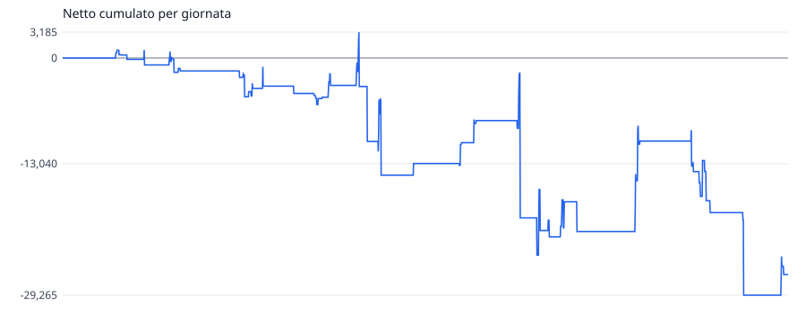
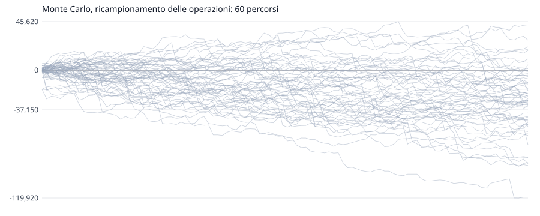

# scala-dei-tre-tempi: validazione dentro campione

Generato il 2026-11-05 12:10 da `quant valida`. Impronta `2b672ed246`, versione 1. Superare i cancelli **non approva** una regola operativa: dice che la prova non l'ha smentita.

## Le Regole

Tempi msg (m mese, s settimana, g giorno), memoria candela (si giudica l'ultima candela chiusa). Scalino su = massimo piu' alto, minimo piu' alto e chiusura sopra il massimo precedente; giu' rovesciato. Ingresso: se tutti i tempi sono nello stesso verso, a mercato alle 09:30 ET in quel verso; con tempi misti niente. Uscita: alle 16:00 ET. Nessuno stop. Dimensione: dai parametri.

L'idea, il paper e il perche': `quant/studi/scala-dei-tre-tempi/1-idea.md`.

- **Parametri**: `contratti=1 dimensione=fissa entra=09:30 esce=16:00 maxContratti=50 memoria=candela tempi=msg`
- **Dimensione**: fissa, 1 contratto
- **Esecuzione**: commissione 2,50 $/lato, slittamento 1 tick su mercato e stop, limite solo se attraversato, ambiguita' al peggio
- **Dati**: NQ m1, rettificata all'indietro ai rollover
- **Divisione**: dentro fino al 2024-12-31 compreso, fissata il 2026-10-15 (80% di 2457 giornate)

## I Cancelli

| | condizione | valore | |
|---|---|---|---|
| D1 | dentro: batte lo stare nel mercato a caso, stesso verso e stessa esposizione (p <= 0,05) | p = 0,858 | **non passa** |
| D2 | dentro: il verso scelto batte la moneta (p <= 0,05) | p = 0,783 | **non passa** |
| D3 | dentro: Sharpe deflazionato per 5 varianti >= 0,95 | 0,072 | **non passa** |

Il fuori campione non e' stato guardato: si guarda una volta, a regole congelate, con `--fuori`.

## I Numeri

| | dentro |
|---|---:|
| periodo | 2017-04-13 -> 2024-12-31 |
| giornate (con operazioni) | 1994 (106) |
| operazioni | 106 |
| netto | -26.720 $ |
| lordo / costi | -26.190 $ / 530 $ |
| vincenti | 50,9% |
| media vincente / perdente | 1.605 $ / -2.181 $ |
| profit factor | 0,76 |
| aspettativa per operazione | -252 $ |
| tick per contratto, media | -49,42 |
| R medio | n/d |
| drawdown massimo (giornate) | 32.450 $ (1179) |
| serie massima di perdite | 7 |
| Sharpe annuo (giornaliero x radice di 252) | -0,30 |
| Sortino annuo | -0,35 |
| **t per giornata** (il test) | **-0,85** |
| t per operazione (ingenuo, non si usa) | -0,85 |
| asimmetria / curtosi giornaliere | -10,71 / 257,93 |
| durata del calcolo | 366 ms su 2.710.499 barre |

Sharpe probabilistico dentro (sopra zero): 0,174. Sharpe deflazionato per 5 varianti nel registro: 0,072.

## Il Modello Nullo

Ogni operazione rifatta togliendo una cosa sola, con le stesse uscite, contratti e costi.

| campione | nullo | netto reale | nullo p5 / p50 / p95 | vantaggio per operazione | p |
|---|---|---:|---:|---:|---:|
| dentro | giornata e minuto a caso, stesso verso e stessa esposizione | -26.720 $ | -44.735 $ / 1.623 $ / 45.651 $ | -267 $ | 0,858 |
| dentro | stesso quando, verso a caso | -26.720 $ | -53.308 $ / -3.550 $ / 51.853 $ | -219 $ | 0,783 |

## Il Monte Carlo

Sulle 106 operazioni dentro campione, 10.000 simulazioni.

| metodo | finale p5 / p50 / p95 | prob. perdita | drawdown p50 / p95 / p99 | serie di perdite p50 / p95 |
|---|---:|---:|---:|---:|
| rimescolamento delle operazioni | -26.720 $ / -26.720 $ / -26.720 $ | 100,0% | 43.370 $ / 58.585 $ / 65.250 $ | 6 / 9 |
| ricampionamento delle operazioni | -79.570 $ / -25.300 $ / 22.061 $ | 80,7% | 43.110 $ / 89.314 $ / 113.033 $ | 6 / 9 |
| ricampionamento per giornata, blocchi di 5 | -76.905 $ / -25.705 $ / 19.096 $ | 82,5% | 41.915 $ / 85.652 $ / 107.646 $ | 2 / 3 |

Il drawdown della sequenza vera e' 32.450 $; il 93% dei rimescolamenti fa peggio. Se quella quota e' piccola, l'ordine vero delle operazioni e' stato fortunato.

### I Metri Per Il Vivo

Il drawdown entro le prime N operazioni, dal ricampionamento. Superare il p95 dal vivo e' un segnale d'allarme; il p99, un motivo per fermarsi.

| operazioni | p50 | p95 | p99 |
|---:|---:|---:|---:|
| 10 | 6.695 $ | 23.080 $ | 31.281 $ |
| 20 | 11.980 $ | 33.436 $ | 45.045 $ |
| 50 | 24.840 $ | 56.490 $ | 72.084 $ |
| 100 | 41.365 $ | 85.621 $ | 108.300 $ |

## Le Uscite

| campione | Stop | Target | Tempo | FineGiornata | Strategia | FineDati |
|---|---:|---:|---:|---:|---:|---:|
| dentro | 0 | 0 | 101 | 5 | 0 | 0 |

Ingressi non fatti nella prima giornata dopo un rollover: dentro 2, fuori 0.
