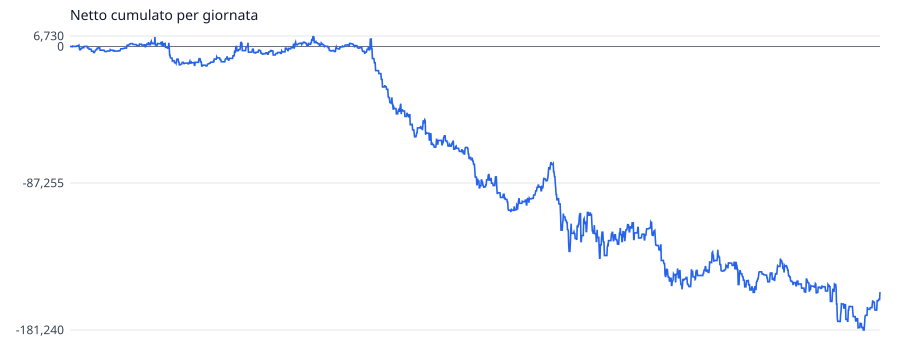
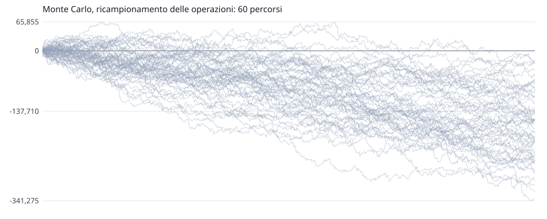

# scala-dei-tre-tempi: validazione dentro campione

Generato il 2026-11-05 12:10 da `quant valida`. Impronta `56bb915abe`, versione 1. Superare i cancelli **non approva** una regola operativa: dice che la prova non l'ha smentita.

## Le Regole

Tempi g (m mese, s settimana, g giorno), memoria candela (si giudica l'ultima candela chiusa). Scalino su = massimo piu' alto, minimo piu' alto e chiusura sopra il massimo precedente; giu' rovesciato. Ingresso: se tutti i tempi sono nello stesso verso, a mercato alle 09:30 ET in quel verso; con tempi misti niente. Uscita: alle 16:00 ET. Nessuno stop. Dimensione: dai parametri.

L'idea, il paper e il perche': `quant/studi/scala-dei-tre-tempi/1-idea.md`.

- **Parametri**: `contratti=1 dimensione=fissa entra=09:30 esce=16:00 maxContratti=50 memoria=candela tempi=g`
- **Dimensione**: fissa, 1 contratto
- **Esecuzione**: commissione 2,50 $/lato, slittamento 1 tick su mercato e stop, limite solo se attraversato, ambiguita' al peggio
- **Dati**: NQ m1, rettificata all'indietro ai rollover
- **Divisione**: dentro fino al 2024-12-31 compreso, fissata il 2026-10-15 (80% di 2457 giornate)

## I Cancelli

| | condizione | valore | |
|---|---|---|---|
| D1 | dentro: batte lo stare nel mercato a caso, stesso verso e stessa esposizione (p <= 0,05) | p = 0,975 | **non passa** |
| D2 | dentro: il verso scelto batte la moneta (p <= 0,05) | p = 0,973 | **non passa** |
| D3 | dentro: Sharpe deflazionato per 5 varianti >= 0,95 | 0,006 | **non passa** |

Il fuori campione non e' stato guardato: si guarda una volta, a regole congelate, con `--fuori`.

## I Numeri

| | dentro |
|---|---:|
| periodo | 2017-04-13 -> 2024-12-31 |
| giornate (con operazioni) | 1994 (851) |
| operazioni | 851 |
| netto | -157.005 $ |
| lordo / costi | -152.750 $ / 4.255 $ |
| vincenti | 49,7% |
| media vincente / perdente | 1.720 $ / -2.066 $ |
| profit factor | 0,82 |
| aspettativa per operazione | -184 $ |
| tick per contratto, media | -35,90 |
| R medio | n/d |
| drawdown massimo (giornate) | 187.970 $ (1395) |
| serie massima di perdite | 8 |
| Sharpe annuo (giornaliero x radice di 252) | -0,70 |
| Sortino annuo | -0,89 |
| **t per giornata** (il test) | **-1,97** |
| t per operazione (ingenuo, non si usa) | -1,97 |
| asimmetria / curtosi giornaliere | -1,23 / 15,60 |
| durata del calcolo | 238 ms su 2.710.499 barre |

Sharpe probabilistico dentro (sopra zero): 0,022. Sharpe deflazionato per 5 varianti nel registro: 0,006.

## Il Modello Nullo

Ogni operazione rifatta togliendo una cosa sola, con le stesse uscite, contratti e costi.

| campione | nullo | netto reale | nullo p5 / p50 / p95 | vantaggio per operazione | p |
|---|---|---:|---:|---:|---:|
| dentro | giornata e minuto a caso, stesso verso e stessa esposizione | -157.005 $ | -128.142 $ / -5.700 $ / 124.653 $ | -178 $ | 0,975 |
| dentro | stesso quando, verso a caso | -157.005 $ | -135.100 $ / -10.580 $ / 123.995 $ | -172 $ | 0,973 |

## Il Monte Carlo

Sulle 851 operazioni dentro campione, 10.000 simulazioni.

| metodo | finale p5 / p50 / p95 | prob. perdita | drawdown p50 / p95 / p99 | serie di perdite p50 / p95 |
|---|---:|---:|---:|---:|
| rimescolamento delle operazioni | -157.005 $ / -157.005 $ / -157.005 $ | 100,0% | 183.845 $ / 222.172 $ / 240.476 $ | 9 / 13 |
| ricampionamento delle operazioni | -287.407 $ / -157.848 $ / -27.269 $ | 97,6% | 188.715 $ / 307.923 $ / 355.564 $ | 9 / 13 |
| ricampionamento per giornata, blocchi di 5 | -292.127 $ / -160.178 $ / -29.126 $ | 97,9% | 190.233 $ / 310.296 $ / 364.765 $ | 3 / 4 |

Il drawdown della sequenza vera e' 187.970 $; il 42% dei rimescolamenti fa peggio. Se quella quota e' piccola, l'ordine vero delle operazioni e' stato fortunato.

### I Metri Per Il Vivo

Il drawdown entro le prime N operazioni, dal ricampionamento. Superare il p95 dal vivo e' un segnale d'allarme; il p99, un motivo per fermarsi.

| operazioni | p50 | p95 | p99 |
|---:|---:|---:|---:|
| 10 | 6.955 $ | 19.090 $ | 25.615 $ |
| 20 | 11.855 $ | 28.036 $ | 36.140 $ |
| 50 | 22.423 $ | 48.078 $ | 60.805 $ |
| 100 | 36.310 $ | 72.641 $ | 90.521 $ |

## Le Uscite

| campione | Stop | Target | Tempo | FineGiornata | Strategia | FineDati |
|---|---:|---:|---:|---:|---:|---:|
| dentro | 0 | 0 | 825 | 26 | 0 | 0 |

Ingressi non fatti nella prima giornata dopo un rollover: dentro 20, fuori 0.
