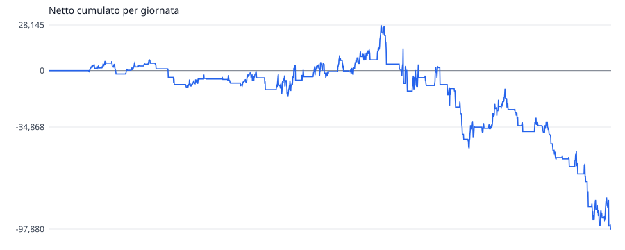
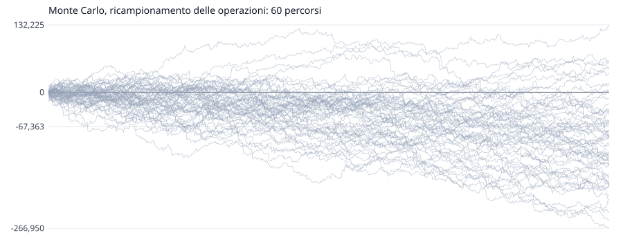

# scala-dei-tre-tempi: validazione dentro campione

Generato il 2026-11-05 12:10 da `quant valida`. Impronta `846d99368f`, versione 1. Superare i cancelli **non approva** una regola operativa: dice che la prova non l'ha smentita.

## Le Regole

Tempi msg (m mese, s settimana, g giorno), memoria scalino (una pausa non cancella l'ultimo scalino). Scalino su = massimo piu' alto, minimo piu' alto e chiusura sopra il massimo precedente; giu' rovesciato. Ingresso: se tutti i tempi sono nello stesso verso, a mercato alle 09:30 ET in quel verso; con tempi misti niente. Uscita: alle 16:00 ET. Nessuno stop. Dimensione: dai parametri.

L'idea, il paper e il perche': `quant/studi/scala-dei-tre-tempi/1-idea.md`.

- **Parametri**: `contratti=1 dimensione=fissa entra=09:30 esce=16:00 maxContratti=50 memoria=scalino tempi=msg`
- **Dimensione**: fissa, 1 contratto
- **Esecuzione**: commissione 2,50 $/lato, slittamento 1 tick su mercato e stop, limite solo se attraversato, ambiguita' al peggio
- **Dati**: NQ m1, rettificata all'indietro ai rollover
- **Divisione**: dentro fino al 2024-12-31 compreso, fissata il 2026-10-15 (80% di 2457 giornate)

## I Cancelli

| | condizione | valore | |
|---|---|---|---|
| D1 | dentro: batte lo stare nel mercato a caso, stesso verso e stessa esposizione (p <= 0,05) | p = 0,939 | **non passa** |
| D2 | dentro: il verso scelto batte la moneta (p <= 0,05) | p = 0,885 | **non passa** |
| D3 | dentro: Sharpe deflazionato per 5 varianti >= 0,95 | 0,028 | **non passa** |

Il fuori campione non e' stato guardato: si guarda una volta, a regole congelate, con `--fuori`.

## I Numeri

| | dentro |
|---|---:|
| periodo | 2017-04-13 -> 2024-12-31 |
| giornate (con operazioni) | 1994 (710) |
| operazioni | 710 |
| netto | -97.880 $ |
| lordo / costi | -94.330 $ / 3.550 $ |
| vincenti | 52,7% |
| media vincente / perdente | 1.555 $ / -2.022 $ |
| profit factor | 0,86 |
| aspettativa per operazione | -138 $ |
| tick per contratto, media | -26,57 |
| R medio | n/d |
| drawdown massimo (giornate) | 126.025 $ (815) |
| serie massima di perdite | 12 |
| Sharpe annuo (giornaliero x radice di 252) | -0,49 |
| Sortino annuo | -0,62 |
| **t per giornata** (il test) | **-1,39** |
| t per operazione (ingenuo, non si usa) | -1,39 |
| asimmetria / curtosi giornaliere | -2,01 / 26,01 |
| durata del calcolo | 371 ms su 2.710.499 barre |

Sharpe probabilistico dentro (sopra zero): 0,077. Sharpe deflazionato per 5 varianti nel registro: 0,028.

## Il Modello Nullo

Ogni operazione rifatta togliendo una cosa sola, con le stesse uscite, contratti e costi.

| campione | nullo | netto reale | nullo p5 / p50 / p95 | vantaggio per operazione | p |
|---|---|---:|---:|---:|---:|
| dentro | giornata e minuto a caso, stesso verso e stessa esposizione | -97.880 $ | -108.245 $ / 7.795 $ / 133.162 $ | -149 $ | 0,939 |
| dentro | stesso quando, verso a caso | -97.880 $ | -133.754 $ / -10.060 $ / 109.408 $ | -124 $ | 0,885 |

## Il Monte Carlo

Sulle 710 operazioni dentro campione, 10.000 simulazioni.

| metodo | finale p5 / p50 / p95 | prob. perdita | drawdown p50 / p95 / p99 | serie di perdite p50 / p95 |
|---|---:|---:|---:|---:|
| rimescolamento delle operazioni | -97.880 $ / -97.880 $ / -97.880 $ | 100,0% | 129.473 $ / 166.405 $ / 182.671 $ | 8 / 11 |
| ricampionamento delle operazioni | -215.063 $ / -96.680 $ / 18.410 $ | 91,4% | 132.453 $ / 236.294 $ / 285.141 $ | 8 / 11 |
| ricampionamento per giornata, blocchi di 5 | -207.723 $ / -97.165 $ / 9.280 $ | 93,3% | 129.545 $ / 226.536 $ / 270.287 $ | 5 / 6 |

Il drawdown della sequenza vera e' 126.025 $; il 57% dei rimescolamenti fa peggio. Se quella quota e' piccola, l'ordine vero delle operazioni e' stato fortunato.

### I Metri Per Il Vivo

Il drawdown entro le prime N operazioni, dal ricampionamento. Superare il p95 dal vivo e' un segnale d'allarme; il p99, un motivo per fermarsi.

| operazioni | p50 | p95 | p99 |
|---:|---:|---:|---:|
| 10 | 6.435 $ | 18.321 $ | 24.871 $ |
| 20 | 10.778 $ | 26.835 $ | 35.440 $ |
| 50 | 20.398 $ | 45.651 $ | 57.136 $ |
| 100 | 32.780 $ | 68.855 $ | 86.331 $ |

## Le Uscite

| campione | Stop | Target | Tempo | FineGiornata | Strategia | FineDati |
|---|---:|---:|---:|---:|---:|---:|
| dentro | 0 | 0 | 683 | 27 | 0 | 0 |

Ingressi non fatti nella prima giornata dopo un rollover: dentro 12, fuori 0.
