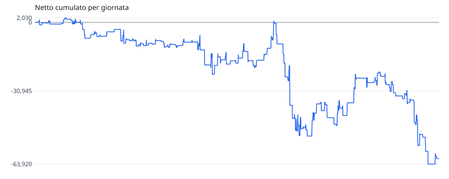
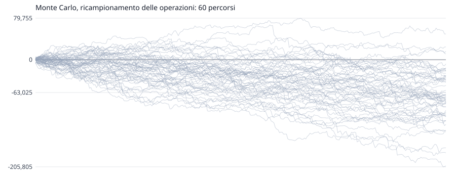

# scala-dei-tre-tempi: validazione dentro campione

Generato il 2026-11-05 12:10 da `quant valida`. Impronta `9e2862e665`, versione 1. Superare i cancelli **non approva** una regola operativa: dice che la prova non l'ha smentita.

## Le Regole

Tempi sg (m mese, s settimana, g giorno), memoria candela (si giudica l'ultima candela chiusa). Scalino su = massimo piu' alto, minimo piu' alto e chiusura sopra il massimo precedente; giu' rovesciato. Ingresso: se tutti i tempi sono nello stesso verso, a mercato alle 09:30 ET in quel verso; con tempi misti niente. Uscita: alle 16:00 ET. Nessuno stop. Dimensione: dai parametri.

L'idea, il paper e il perche': `quant/studi/scala-dei-tre-tempi/1-idea.md`.

- **Parametri**: `contratti=1 dimensione=fissa entra=09:30 esce=16:00 maxContratti=50 memoria=candela tempi=sg`
- **Dimensione**: fissa, 1 contratto
- **Esecuzione**: commissione 2,50 $/lato, slittamento 1 tick su mercato e stop, limite solo se attraversato, ambiguita' al peggio
- **Dati**: NQ m1, rettificata all'indietro ai rollover
- **Divisione**: dentro fino al 2024-12-31 compreso, fissata il 2026-10-15 (80% di 2457 giornate)

## I Cancelli

| | condizione | valore | |
|---|---|---|---|
| D1 | dentro: batte lo stare nel mercato a caso, stesso verso e stessa esposizione (p <= 0,05) | p = 0,911 | **non passa** |
| D2 | dentro: il verso scelto batte la moneta (p <= 0,05) | p = 0,898 | **non passa** |
| D3 | dentro: Sharpe deflazionato per 5 varianti >= 0,95 | 0,029 | **non passa** |

Il fuori campione non e' stato guardato: si guarda una volta, a regole congelate, con `--fuori`.

## I Numeri

| | dentro |
|---|---:|
| periodo | 2017-04-13 -> 2024-12-31 |
| giornate (con operazioni) | 1994 (297) |
| operazioni | 297 |
| netto | -61.375 $ |
| lordo / costi | -59.890 $ / 1.485 $ |
| vincenti | 50,8% |
| media vincente / perdente | 1.580 $ / -2.055 $ |
| profit factor | 0,80 |
| aspettativa per operazione | -207 $ |
| tick per contratto, media | -40,33 |
| R medio | n/d |
| drawdown massimo (giornate) | 65.950 $ (1839) |
| serie massima di perdite | 8 |
| Sharpe annuo (giornaliero x radice di 252) | -0,47 |
| Sortino annuo | -0,57 |
| **t per giornata** (il test) | **-1,32** |
| t per operazione (ingenuo, non si usa) | -1,32 |
| asimmetria / curtosi giornaliere | -4,01 / 65,51 |
| durata del calcolo | 313 ms su 2.710.499 barre |

Sharpe probabilistico dentro (sopra zero): 0,082. Sharpe deflazionato per 5 varianti nel registro: 0,029.

## Il Modello Nullo

Ogni operazione rifatta togliendo una cosa sola, con le stesse uscite, contratti e costi.

| campione | nullo | netto reale | nullo p5 / p50 / p95 | vantaggio per operazione | p |
|---|---|---:|---:|---:|---:|
| dentro | giornata e minuto a caso, stesso verso e stessa esposizione | -61.375 $ | -77.501 $ / 2.538 $ / 77.696 $ | -215 $ | 0,911 |
| dentro | stesso quando, verso a caso | -61.375 $ | -77.381 $ / -1.890 $ / 77.790 $ | -200 $ | 0,898 |

## Il Monte Carlo

Sulle 297 operazioni dentro campione, 10.000 simulazioni.

| metodo | finale p5 / p50 / p95 | prob. perdita | drawdown p50 / p95 / p99 | serie di perdite p50 / p95 |
|---|---:|---:|---:|---:|
| rimescolamento delle operazioni | -61.375 $ / -61.375 $ / -61.375 $ | 100,0% | 81.795 $ / 105.886 $ / 116.575 $ | 7 / 10 |
| ricampionamento delle operazioni | -136.831 $ / -60.905 $ / 14.126 $ | 90,8% | 84.098 $ / 150.446 $ / 183.332 $ | 7 / 11 |
| ricampionamento per giornata, blocchi di 5 | -136.568 $ / -60.070 $ / 7.936 $ | 92,3% | 81.533 $ / 147.998 $ / 178.031 $ | 3 / 3 |

Il drawdown della sequenza vera e' 65.950 $; il 94% dei rimescolamenti fa peggio. Se quella quota e' piccola, l'ordine vero delle operazioni e' stato fortunato.

### I Metri Per Il Vivo

Il drawdown entro le prime N operazioni, dal ricampionamento. Superare il p95 dal vivo e' un segnale d'allarme; il p99, un motivo per fermarsi.

| operazioni | p50 | p95 | p99 |
|---:|---:|---:|---:|
| 10 | 6.695 $ | 19.571 $ | 26.776 $ |
| 20 | 11.310 $ | 28.391 $ | 38.472 $ |
| 50 | 22.480 $ | 48.887 $ | 62.790 $ |
| 100 | 36.713 $ | 74.511 $ | 92.406 $ |

## Le Uscite

| campione | Stop | Target | Tempo | FineGiornata | Strategia | FineDati |
|---|---:|---:|---:|---:|---:|---:|
| dentro | 0 | 0 | 284 | 13 | 0 | 0 |

Ingressi non fatti nella prima giornata dopo un rollover: dentro 9, fuori 0.
